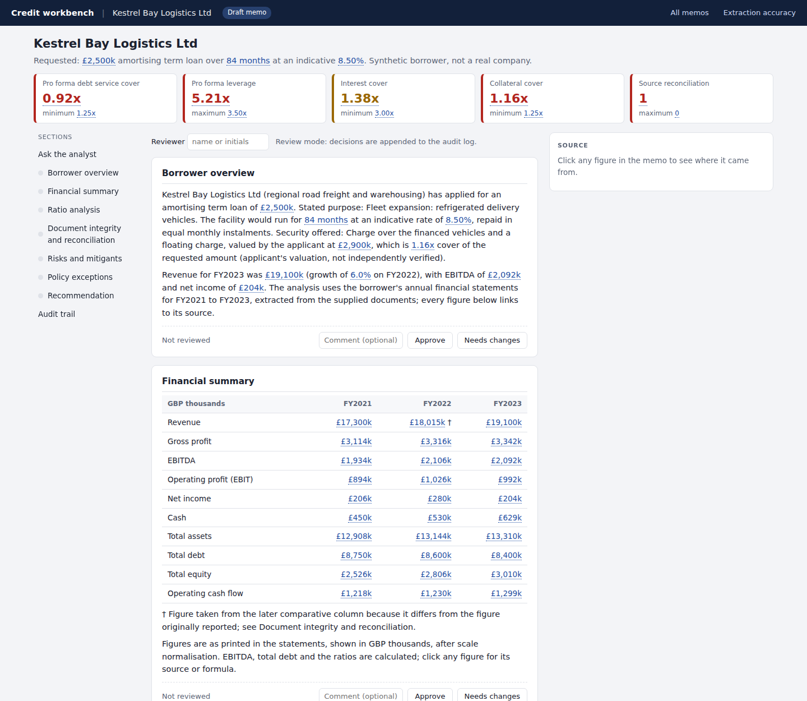
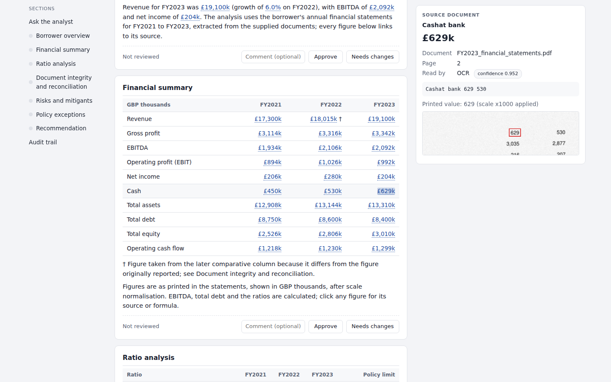
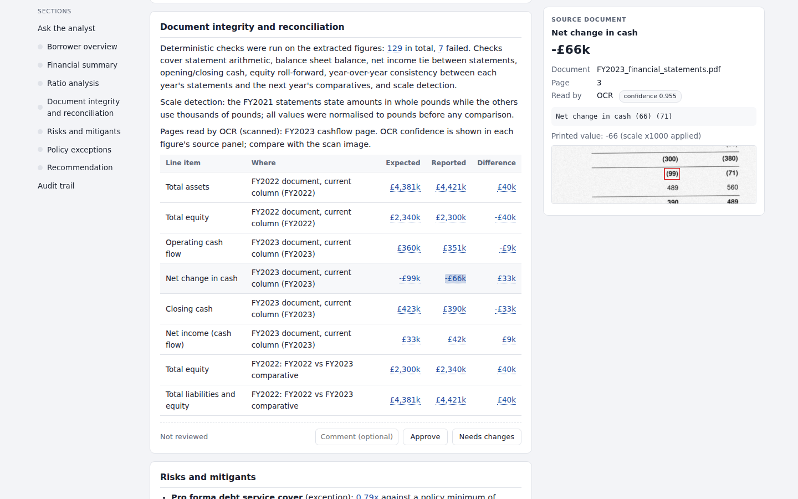
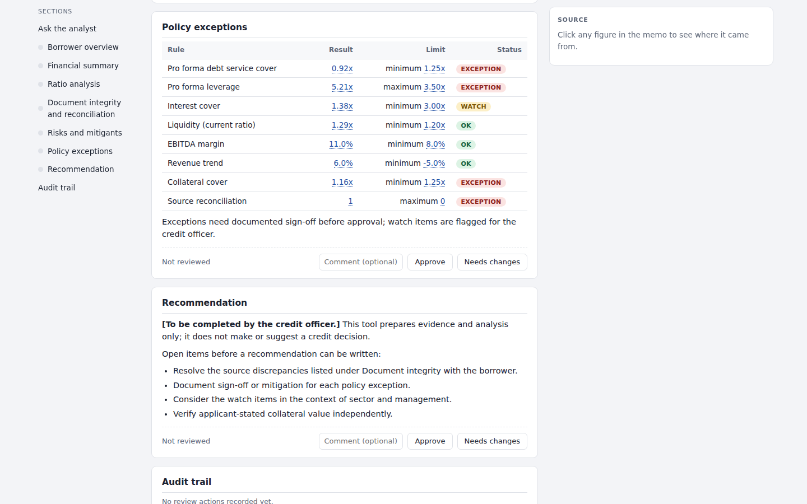
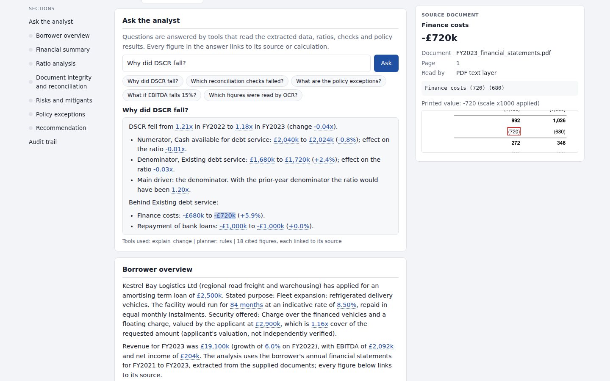
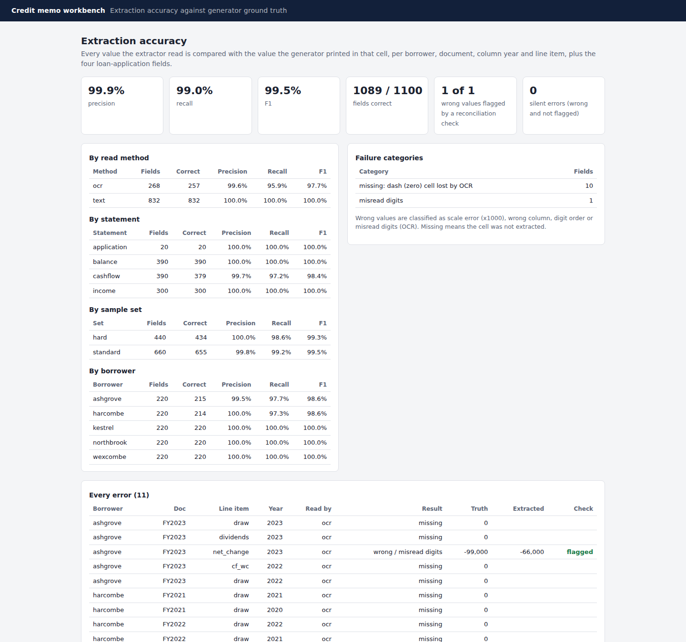
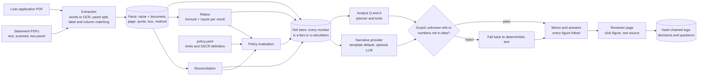

# Source-linked credit memo drafter


*About 25 seconds, recorded from the real review page and real pipeline output: a failed reconciliation check, click the misread figure to see the scan, ask "Why did DSCR fall?", approve a section. ([MP4](docs/demo.mp4))*

A working prototype of a workflow a commercial lender would recognise: take a borrower's financial statements
(some of them scanned) and a loan application, extract the numbers with their sources, check them
deterministically, compute ratios against a configurable policy, and draft a credit memo in which **every number
is a link back to the page and snippet it came from**. A reviewer approves or challenges each section, can ask an
analyst assistant questions whose answers are sourced the same way, and every decision and question goes to an
append-only, hash-chained log.

Everything here is synthetic: five fictional borrowers generated by `creditmemo/synth.py`. No real companies,
banks or people are involved, and nothing in the repo is a production metric.

## Screenshots

Captured headless from the review pages by `scripts/capture.py` (page content only).


*Draft memo: policy KPI strip on top, every figure in the tables is a link.*


*Click a figure: document, page, read method (OCR confidence here), the quoted line and the page crop with the value boxed.*


*Document integrity: seven failed checks for one borrower, with the misread scanned figure (66 instead of 99) opened.*


*Policy results against the limits in `policy.yaml`: exceptions, watch items and passes.*


*Analyst Q&A: "Why did DSCR fall?" answered from tool calls, every number linked, one opened to its source crop.*


*Extraction accuracy against the generator's ground truth, by read method, statement and set, with every error listed.*

## Problem

Credit analysts spend much of their time re-keying figures from PDFs into a memo, and reviewers then have to
trust (or re-check) those figures. Two things make that fragile: numbers get detached from their source, and
inconsistencies between documents (restated comparatives, an unbalanced balance sheet, thousands vs whole pounds,
an OCR misread) are found late or not at all. An LLM that writes or answers questions makes the first problem
worse unless its numbers are constrained to the extracted data.

## What it does

| Stage | What happens | Code |
|---|---|---|
| Inputs | 3 fictional SMEs, 3 annual statement PDFs each (income statement, balance sheet, cash flow, prior-year comparatives) plus a one-page loan application; two pages are noisy scans. A second, harder set (below) adds a note-reference column, two statements side by side next to prose notes, and a fully scanned borrower. | `synth.py` |
| Extraction | Text-layer words, or OCR for scans, grouped into rows; labels matched to a canonical line item (aliases plus fuzzy match); numbers assigned to columns by right-alignment with the year headers, so a dropped cell or a note reference cannot shift the rest; pages with two panels are split at the whitespace channel next to each year-header group. Each value keeps document, page, quoted line, box and read method (`text` or `ocr` with confidence). | `extract.py` |
| Reconciliation | Statement arithmetic, balance sheet balance, net income tie between statements, opening/closing cash, equity roll-forward, year-over-year consistency between each year's statements and the next year's comparatives, scale detection (thousands vs pounds), magnitude plausibility. | `reconcile.py` |
| Analysis | EBITDA margin, current ratio, leverage, interest cover, DSCR (historic and pro forma with the new loan's annuity), revenue growth, collateral cover. Each result stores formula and inputs. DSCR's cash-flow definition is set in the policy file (below). | `ratios.py` |
| Policy | Rules in `policy.yaml` (operator, threshold, severity `exception` or `watch`). Edit and re-run. | `policy.py` |
| Memo | Markdown and HTML: overview, financial summary, ratios with formulas, document integrity, risks and mitigants, policy exceptions, a recommendation placeholder for the human. | `memo.py`, `narrative.py` |
| No unsourced numbers | Narrative and Q&A text may only carry figures as `[[ref]]` placeholders. A guard rejects unknown refs and any number not in the data; a final scan of the rendered memo fails the run if a digit sits outside a source link. | `guard.py` |
| Analyst Q&A | A tool-using loop (planner, tool call, observation, final text, guard) over the extracted data. Offline rule planner by default; optional LLM planner through the same guard. Questions and answers are logged to a hash chain. | `qa.py` |
| Evaluation | Field-level precision and recall against the generator's ground truth, by method, statement and set, with failure categories and whether a reconciliation check caught each wrong value. | `evaluation.py` |
| Review | Local web page styled as an internal credit tool: KPI strip, section navigation, click any figure for its source crop or formula, Q&A panel, approve or request changes per section, audit trail. | `server.py`, `audit.py`, `evidence.py`, `memo.py` |

## Architecture



## How to run

Requires Python 3.10+. One command creates a virtual environment, installs dependencies, runs the tests, runs the
pipeline and writes the extraction report:

```
./run.sh
```

Then open `out/index.html` directly (read-only, figures are clickable), or start the review server:

```
. .venv/bin/activate
python -m creditmemo review --port 8765      # then browse to http://localhost:8765/
python -m creditmemo ask kestrel "Why did DSCR fall?"     # same Q&A from the command line, with a source list
python -m creditmemo eval                    # extraction accuracy, writes out/eval.html and out/eval.json
python -m creditmemo verify-audit            # check both hash chains (reviews and questions)
```

`python -m creditmemo run --regen` rebuilds the sample PDFs; `--policy other.yaml` uses a different policy file.
Sample PDFs are committed in `sample_data/` and `sample_hard/`; generated outputs go to `out/` (git-ignored).
Example outputs from a real run are in `examples/`. `make screenshots` and `make demo` (needs
`pip install -r requirements-dev.txt` and Chrome or Chromium) re-create the images and the recording.

## Analyst Q&A

Ask in the review page or with `python -m creditmemo ask <borrower> "<question>"`. The loop calls read-only tools
(`lookup`, `explain_change`, `policy_status`, `failed_checks`, `ocr_figures`, `stress_ebitda`) over the borrower's
extracted facts, ratios, checks and policy results. Calculations the tools create on the fly (a change, the effect of
the numerator and of the denominator, a stress case) are added to a request-scoped reference store with their formula
and inputs, so they open in the source panel just like the memo's figures.

Example, Kestrel Bay (`ask kestrel "Why did DSCR fall?"`):

```
DSCR fell from 1.21x in FY2022 to 1.18x in FY2023 (change -0.04x).
- Numerator, Cash available for debt service: £2,040k to £2,024k (-0.8%); effect on the ratio -0.01x.
- Denominator, Existing debt service: £1,680k to £1,720k (+2.4%); effect on the ratio -0.03x.
- Main driver: the denominator. With the prior-year denominator the ratio would have been 1.20x.
Behind Existing debt service:
- Finance costs: -£680k to -£720k (+5.9%).
```

Other questions it answers: which reconciliation checks failed and by how much, which policy rules are breached, what
a metric is and how it is calculated, which figures came from OCR and how confident the engine was, and stress cases
("What if EBITDA falls 15%?" gives the stressed pro forma DSCR and leverage against the policy limits). A request to
approve or decline gets the evidence and a statement that the decision stays with the credit officer.

Two planners share the loop. The rule planner is deterministic and offline: keyword intents choose tool sequences and
fixed templates write the answer. The LLM planner (`CREDIT_MEMO_PROVIDER=llm` with `CREDIT_MEMO_LLM_URL`, optional
`_MODEL` and `_AUTH`, any OpenAI-compatible chat endpoint) must reply in JSON, either a tool call or a final text
with `[[ref]]` placeholders. Its final text goes through the guard; an unknown ref, an invented number, malformed
JSON, a network failure or exceeding the step limit all fall back to the rule planner's answer and the response says so.
Those paths are tested with scripted fake models; no live model has been called.

## DSCR definition per policy

The numerator of DSCR is set in `policy.yaml`; the denominator is always existing interest plus principal repaid
(plus the new loan's annuity for the pro forma figure).

```yaml
dscr:
  cfads: ebitda_less_tax          # or ebitda_less_tax_less_capex, or cfo_plus_interest
  capex_share: 1.0                # only for ebitda_less_tax_less_capex: share of capex deducted
```

| `cfads` | Cash available for debt service |
|---|---|
| `ebitda_less_tax` (default) | EBITDA less income tax |
| `ebitda_less_tax_less_capex` | EBITDA less income tax less `capex_share` x capital expenditure (a lender that deducts maintenance capex) |
| `cfo_plus_interest` | operating cash flow (after tax and working capital) plus interest paid |

An unknown value is rejected when the policy loads. The chosen definition appears in the memo's formula lines and in
Q&A answers with its inputs linked, and a `capex_share` is itself a linked policy figure.

## Extraction accuracy

`python -m creditmemo eval` scores every extracted cell against the value the generator printed (borrower, document,
column year, line item) plus the four application fields, over 5 borrowers, 15 statement documents and 1,100 fields.
Numbers from a real run:

| | Fields | Correct | Precision | Recall |
|---|---|---|---|---|
| All | 1,100 | 1,089 | 99.9% | 99.0% |
| Standard set (3 borrowers, 2 scanned pages) | 660 | 655 | 99.8% | 99.2% |
| Harder set (2 borrowers, 9 scanned pages) | 440 | 434 | 100.0% | 98.6% |
| Read from PDF text layer | 832 | 832 | 100.0% | 100.0% |
| Read by OCR | 268 | 257 | 99.6% | 95.9% |

Failure categories: 10 cells missing because OCR lost a dash (a printed zero), 1 misread number (Ashgrove net change
in cash, 66 for 99). The misread is flagged by two failed reconciliation checks, so no wrong value passed silently
(wrong values flagged: 1 of 1). Missing cells are not reconciled, so they surface as skipped checks and as an
extraction warning ("label read by OCR but no numbers"), not as numbers.

The harder set (`sample_hard/`, generated by `synth.generate_hard`) has a note-reference column that sits close to the
first year column, landscape pages with the income statement beside the cash flow statement and the balance sheet
beside prose notes, and one borrower whose every page is a heavier scan (rotation, noise, blur). Both go through the
whole pipeline in the tests; the scanned one carries a planted cash flow defect that the checks find.

## Results from a real run

Run output on the three standard borrowers (27 statement pages, 2 of them scanned and read by OCR):

| | Northbrook Precision Tooling | Kestrel Bay Logistics | Ashgrove Bakery |
|---|---|---|---|
| Values extracted | 216 | 216 | 212 |
| Reconciliation checks run / failed | 128 / 0 | 128 / 1 | 129 / 7 |
| FY2023 revenue | 12,100k | 19,100k | 5,700k |
| EBITDA margin | 18.0% | 11.0% | 8.7% |
| Leverage (debt / EBITDA) | 1.19x | 4.02x | 2.83x |
| Interest cover | 8.74x | 1.38x | 1.34x |
| DSCR historic / pro forma with new loan | 3.11x / 1.79x | 1.18x / 0.92x | 1.12x / 0.79x |
| Pro forma leverage | 2.02x | 5.21x | 4.05x |
| Collateral cover | 1.44x | 1.16x | 0.75x |
| Policy exceptions | none | DSCR, leverage, collateral, reconciliation | DSCR, leverage, collateral, reconciliation |

Amounts in GBP. Limits are the illustrative ones in `policy.yaml` (for example DSCR at least 1.25x).

What the checks found, all planted or arising from the generated documents:

- **Kestrel Bay, restated comparative.** FY2022 revenue is 18,420k in the FY2022 statements but 18,015k in the FY2023
  comparative column (cost of sales moves by the same 405k). Flagged as a year-over-year failure; the memo uses the
  later figure and marks it with a dagger.
- **Ashgrove, balance sheet does not balance.** FY2022 total assets 4,421k against liabilities plus equity 4,381k
  (a 40k gap), which also fails the equity roll-forward and disagrees with the FY2023 comparative.
- **Ashgrove, net income mismatch.** FY2023 net income is 33k on the income statement but 42k on the cash flow statement.
- **Ashgrove, scale.** The FY2021 statements are in whole pounds, the others in thousands. Detected per document and
  normalised; reported as informational.
- **OCR on the scanned pages.** The scanned Kestrel Bay balance sheet was read with all 26 values correct. On the
  scanned Ashgrove cash flow page, OCR dropped dash cells and misread the net change in cash as (66) instead of (99);
  the cash roll-forward and cash flow arithmetic checks both failed on it. Of the seven Ashgrove failures, five trace to
  the planted defects and two to this misread.

Test run (`python -m pytest -q`): `__TESTS__`. They cover extraction against the printed values (including OCR pages,
note columns and two-panel pages), reconciliation, ratios against hand calculations, the three DSCR definitions, the
policy file, the unsourced-number guard (including a fake model that invents a number), the Q&A tools, planners and
fallbacks, the eval numbers, the audit chains and the review server. The suite OCRs a dozen pages, so it takes a few
minutes on a busy machine.

Example memo excerpt (Kestrel Bay, from `examples/kestrel_memo.md`; each figure is a link in the real file):

```
Pro forma debt service cover (exception): 0.92x against a policy minimum of 1.25x.
Pro forma leverage (exception): 5.21x against a policy maximum of 3.50x.
Revenue for FY2022 is £18,420k in the original statements but £18,015k in the later comparative column (difference -£405k).
```

## Limitations

- Synthetic inputs. The harder set shows robustness to note columns, side-by-side panels and heavy scan noise, but all
  documents are still generated with a small set of fonts and line items; real statements have merged cells, wrapped
  labels, sign conventions and notes with their own tables. No accuracy claim is made for real documents.
- OCR drops dash cells (printed zeros) in scans. It is reported as missing with a warning, never guessed, and a
  misread digit is only caught when it breaks an accounting identity.
- A panel split relies on whitespace between side-by-side tables; a long line running across both would defeat it.
- "Latest document wins" when a period appears in two documents: a stated convention, with the discrepancy always reported.
- Collateral value is whatever the application states, with no valuation or haircut logic. DSCR offers three
  definitions; real policies add leases, covenants and working-capital rules.
- The guard checks numbers, not claims: a model could still write a false qualitative statement. The rule planner is
  the default for that reason, and nothing here makes a credit decision.
- No live LLM has been called. The HTTP provider and the LLM planner are covered by tests with fake models only.
- The review page is a local demo: no authentication, a free-text reviewer name, a single machine. Hash chaining makes
  tampering detectable but the logs are not otherwise protected.

## Next steps

- Measure on a set of real (consented, anonymised) statements, with per-field confidence thresholds that route
  low-confidence values to review.
- Table detection and layout-aware extraction for notes and schedules.
- Covenant and structure modelling (amortisation profiles, balloon, refinancing, shock cases beyond EBITDA).
- Per-lender policy packs and exception workflows (approver roles, expiry, conditions precedent).
- Reviewer edits that write back as overrides with their own audit entries, and memo versioning against source hashes.

## Layout

```
creditmemo/   pipeline code (synth, extract, reconcile, ratios, policy, narrative, guard, memo, qa, evaluation, server, audit)
policy.yaml   policy limits and the DSCR definition
sample_data/  generated synthetic PDFs, standard set (committed)
sample_hard/  generated synthetic PDFs, harder set (committed)
tests/        pytest suite
scripts/      screenshot and demo recording (Playwright)
examples/     memos produced by a real run
docs/         demo GIF and MP4, screenshots, captured run output used by the recording
run.sh        install, test, run and evaluate in one command
Makefile      test, run, eval, screenshots, demo
```
