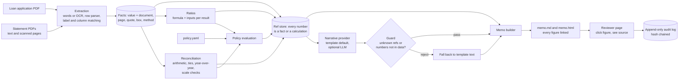

# Source-linked credit memo drafter

A small, working prototype of a workflow a commercial lender would recognise: take a borrower's
financial statements (some of them scanned) and a loan application, extract the numbers with their
sources, check them deterministically, compute ratios against a configurable policy, and draft a
credit memo in which **every number is a link back to the page and snippet it came from**. A reviewer
then approves or challenges each section, and every decision goes to an append-only audit log.

Everything here is synthetic: three fictional borrowers, generated by `creditmemo/synth.py`. No real
companies, banks or people are involved, and nothing in the repo is a production metric.

## Problem

Credit analysts spend much of their time re-keying figures from PDFs into a memo, and reviewers then
have to trust (or re-check) those figures. Two things make that fragile: numbers get detached from their
source, and inconsistencies between documents (restated comparatives, an unbalanced balance sheet,
thousands vs whole pounds, an OCR misread) are found late or not at all. An LLM that writes the memo
makes the first problem worse unless its numbers are constrained to the extracted data.

## What it does

| Stage | What happens | Code |
|---|---|---|
| Inputs | 3 fictional SMEs, 3 annual statement PDFs each (income statement, balance sheet, cash flow, with prior-year comparatives) plus a one-page loan application. Two statement pages are rendered as noisy, slightly rotated scans (image only). | `synth.py` |
| Extraction | Text-layer words, or OCR for scans, grouped into rows; labels matched to a canonical line item (aliases plus fuzzy match); numbers assigned to columns by right-alignment with the year headers (so one dropped cell cannot shift the rest). Each value keeps document, page, the quoted line, a normalised box and the read method (`text` or `ocr` with confidence). | `extract.py` |
| Reconciliation | Statement arithmetic (gross profit to net income, balance sheet totals, cash flow totals), balance sheet balances, net income ties between statements, opening and closing cash, equity roll-forward, year-over-year consistency between each year's statements and the next year's comparatives, scale detection (thousands vs whole pounds) and a magnitude plausibility check. | `reconcile.py` |
| Analysis | EBITDA margin, current ratio, leverage, interest cover, DSCR (historic and pro forma including the new loan's annuity payment), revenue growth, collateral cover. Each result stores its formula and inputs. | `ratios.py` |
| Policy | Rules in `policy.yaml` (operator, threshold, severity `exception` or `watch`). Edit and re-run. | `policy.py` |
| Memo | Markdown and HTML: borrower overview, financial summary, ratio analysis with formulas, document integrity, risks and mitigants, policy exceptions, and a recommendation placeholder for the human. | `memo.py`, `narrative.py` |
| No unsourced numbers | Narrative may only carry figures as `[[ref]]` placeholders. A guard rejects unknown refs and any number that is not in the data; a final scan of the rendered memo fails the run if any digit sits outside a source link. | `guard.py` |
| Review | Local web page: click any figure to see its source crop (with the value boxed), document, page, quote and read method, or its formula with clickable inputs. Mark each section approved or needs-changes. Decisions are appended to a hash-chained JSON-lines log. | `server.py`, `audit.py`, `evidence.py` |

## Architecture



## How to run

Requires Python 3.10+. One command creates a virtual environment, installs dependencies, runs the
tests and runs the pipeline:

```
./run.sh
```

Then open `out/index.html` directly (read-only, figures are clickable), or start the review server:

```
. .venv/bin/activate
python -m creditmemo review --port 8765      # then browse to http://localhost:8765/
python -m creditmemo verify-audit            # check the audit log hash chain
```

Other commands: `python -m creditmemo run --regen` rebuilds the sample PDFs; `--policy other.yaml`
uses a different policy file. The sample PDFs are committed in `sample_data/`; generated outputs go to
`out/` (git-ignored). Example outputs from a real run are in `examples/`.

### Optional LLM narrative

The default narrative backend is a deterministic template and needs no network. To let a model reword the
three narrative sections, set `CREDIT_MEMO_PROVIDER=llm`, `CREDIT_MEMO_LLM_URL` (an OpenAI-compatible chat
completions endpoint), optionally `CREDIT_MEMO_LLM_MODEL` and `CREDIT_MEMO_LLM_AUTH`. Nothing is read from
files and no credentials are stored in the repo. The model is given the draft and the list of allowed
references and must write every figure as a `[[ref]]` placeholder. Its output goes through the same guard
as the template: any unknown reference or any number that does not match the data rejects the section and
the deterministic text is used instead (a note is added to the memo and the run output). The HTTP provider
itself has not been exercised against a live endpoint; the guard and fallback are covered by tests using
fake providers.

## Results from a real run

Run output on the three synthetic borrowers (27 statement pages, 2 of them scanned and read by OCR):

| | Northbrook Precision Tooling | Kestrel Bay Logistics | Ashgrove Bakery |
|---|---|---|---|
| Values extracted | 216 | 216 | 212 |
| Reconciliation checks run / failed | 128 / 0 | 128 / 1 | 129 / 7 |
| FY2023 revenue | 12,100k | 19,100k | 5,700k |
| EBITDA margin | 18.0% | 11.0% | 8.7% |
| Leverage (debt / EBITDA) | 1.19x | 4.02x | 2.83x |
| Interest cover | 8.74x | 1.38x | 1.34x |
| DSCR historic / pro forma with new loan | 3.11x / 1.79x | 1.18x / 0.92x | 1.12x / 0.79x |
| Pro forma leverage | 2.02x | 5.21x | 4.05x |
| Collateral cover | 1.44x | 1.16x | 0.75x |
| Policy exceptions | none | DSCR, leverage, collateral, reconciliation | DSCR, leverage, collateral, reconciliation |

Amounts in GBP. Policy limits are the illustrative ones in `policy.yaml` (for example DSCR at least 1.25x).

What the checks found, all planted or arising from the generated documents:

- **Kestrel Bay, restated comparative.** FY2022 revenue is 18,420k in the FY2022 statements but 18,015k in the
  FY2023 comparative column (cost of sales moves by the same 405k). Flagged as a year-over-year failure; the
  memo uses the later figure and marks it with a dagger.
- **Ashgrove, balance sheet does not balance.** FY2022 total assets 4,421k against liabilities plus equity
  4,381k (a 40k gap), which also fails the equity roll-forward and disagrees with the FY2023 comparative.
- **Ashgrove, net income mismatch.** FY2023 net income is 33k on the income statement but 42k on the
  cash flow statement.
- **Ashgrove, scale.** The FY2021 statements are in whole pounds, the others in thousands. Detected per
  document and normalised; reported as informational, not a failure.
- **OCR on the scanned pages.** The scanned Kestrel Bay balance sheet was read with all 26 values correct.
  On the scanned Ashgrove cash flow page, 22 of 26 cells were extracted (OCR dropped four, for example the
  dash for a zero dividend) and 21 of those 22 were right; the net change in cash was misread as (66)
  instead of (99). The cash roll-forward and cash flow arithmetic checks both failed on it, so the misread
  did not pass silently. Of the seven Ashgrove failures, five trace to the planted defects and two to this
  OCR misread. The memo lists all of them.

Test run (`python -m pytest -q`): `32 passed` in about 25 seconds. They cover extraction against the known
printed values (including OCR pages), reconciliation (restatement, imbalance, net income tie, scale),
ratios against hand calculations and formula inputs, the policy file, the unsourced-number guard (including a
fake model that invents a number and gets rejected), the audit log and the review server.

Example memo excerpt (Kestrel Bay, from `examples/kestrel_memo.md`; each figure is a link in the real file):

```
Pro forma debt service cover (exception): 0.92x against a policy minimum of 1.25x.
Pro forma leverage (exception): 5.21x against a policy maximum of 3.50x.
Revenue for FY2022 is £18,420k in the original statements but £18,015k in the later comparative column (difference -£405k).
```

A source crop as shown in the reviewer panel (scanned page, value boxed): `docs/source_crop_scanned.png`.

## Limitations

- Synthetic inputs with clean, regular layouts. Real statements have notes, multi-column layouts, merged
  cells, different line items and sign conventions; the label alias table and row parser would need to be
  extended and measured on real documents. No extraction accuracy claim is made beyond these samples.
- OCR is a general-purpose engine on mild noise. It misread one number in the samples (above); the design
  relies on deterministic checks to catch such errors, which only works when the misread breaks an identity.
- DSCR here is (EBITDA less income tax) divided by (interest plus principal repaid), with existing debt
  service assumed to continue. Real policies define cash flow available for debt service differently
  (working capital, capex, lease payments, covenants).
- "Latest document wins" is used when a period appears in two documents. That is a stated convention, not a
  judgement about which figure is right; the discrepancy is always reported.
- Collateral value is whatever the application states, with no valuation or haircut logic.
- The guard checks numbers, not claims. A model could still write a false qualitative statement; the
  template is the default for that reason, and the memo does not make a credit decision.
- The review page is a local demo: no authentication, a free-text reviewer name, single machine.
  Hash chaining makes tampering detectable but the log is not otherwise protected.
- The optional HTTP LLM provider is untested against a live service.

## Next steps

- Run on a set of real (consented, anonymised) statements and measure field-level accuracy, with per-field
  confidence thresholds that route low-confidence values to review.
- Pluggable layout-aware extraction for notes and schedules, with table detection instead of line grouping.
- Covenant and structure modelling (amortisation profiles, balloon, refinancing of existing debt, sensitivity
  cases such as a revenue or margin shock).
- Per-lender policy packs and exception workflows (approver roles, expiry, conditions precedent).
- Reviewer edits that write back as overrides with their own audit entries, and memo versioning against
  source document hashes.

## Layout

```
creditmemo/   pipeline code (synth, extract, reconcile, ratios, policy, narrative, guard, memo, server, audit)
policy.yaml   configurable policy rules
sample_data/  generated synthetic PDFs (committed)
tests/        pytest suite
examples/     memos produced by a real run
docs/         example source crop
run.sh        install, test and run in one command
```
